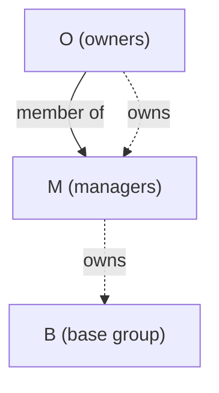
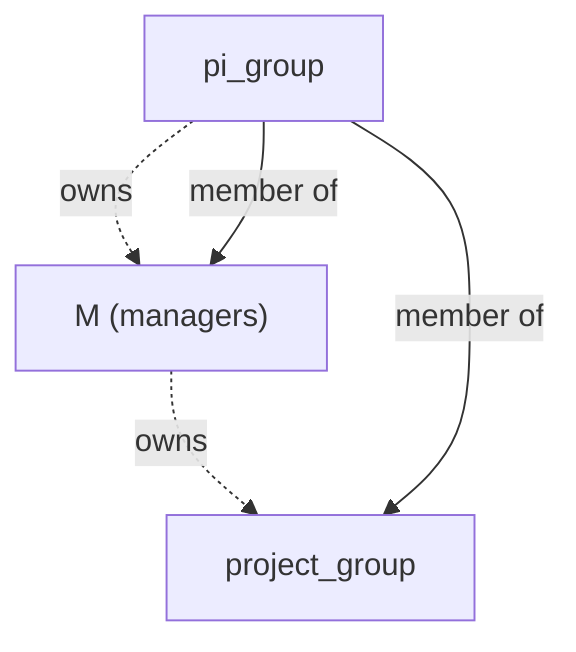

This design document lays out the new principles and implementations of the UserApp's new management system.

TLDR; Groups are the single primitive. Projects, and login access are metadata on top of groups that grant access to a group's effective members.

## Group

A group is a set of people administered by its owners.

Properties:
- Members can include users and groups.
- Effective members are the unique set of users reachable through member users and member groups, flattened.
- Only staff (`is_admin == true`) can create groups.
- `owner_group` references another group. Effective members of the owner group are the group's owners. `null` means staff only.
- Only staff set or change `owner_group`.
- A group cannot own itself, and ownership cannot loop (for example `M` owns `O` while `O` owns `M`). Either would let a lower tier promote itself.
- A group cannot be a member of itself or of any group it contains (no cycles).
- Both cycle checks run on write under a lock.

```
id: int (Primary Key)
name: unix name (format enforced by the application)
unix_gid: unix group id, unique (null implies no unix group)
owner_group: group.id or null (null implies staff only)
description: string
...
members: implied through group_members table
```

### Permissions

One rule covers every group: an actor can administer a group if they are staff or an effective member of its `owner_group`.

| Action                      | Staff | Owners |
| --------------------------- | ----- | ------ |
| Create groups               | ✓     |        |
| Set or change `owner_group` | ✓     |        |
| Add or remove members       | ✓     | ✓      |
| Edit description            | ✓     |        |
| Set name or `unix_gid`      | ✓     |        |
| View group and access pages | ✓     | ✓      |

Owning a group lets you edit its members. It never lets you change who owns it.

### Default administration structure

Tiers of administration come from chaining ownership. When staff create a group `B` that needs delegated management, two administrator groups are created with it:

|Group|`owner_group`|Members|Who edits its membership|
|---|---|---|---|
|`O` (owners)|null|Owners|Staff|
|`M` (managers)|`O`|Managers, plus group `O`|Owners|
|`B` (base)|`M`|Anyone|Managers and owners|



- Owners add and remove managers because `O` owns `M`.
- Managers add and remove members of `B` because `M` owns `B`.
- Owners can also edit `B` because `O` is a member of `M`. Owning `M` alone would not be enough.
- Managers cannot add managers, because they don't own `M`.

A group that doesn't need delegation skips `M`: `B` is owned by `O` directly. A deeper delegation chain adds another link. "Owners" and "managers" are labels in the UI; the data model has only ownership.

Administrators are not members of `B` by default, so they don't receive the access `B` grants. To give them access, add them to `B` directly, or add `M` to `B` as a member.

Staff can also point a new group's `owner_group` at an existing group instead of creating new administrator groups.

### Effective membership

The application stores effective membership in a materialized table. Every membership change recomputes it in the same transaction. All reads go through it: the UI, access checks, Unix group generation, and downstream consumers.

Removing a member changes only effective membership. It never deletes other membership rows.

### Deletion

Groups are never hard-deleted. Deleting a group sets `deleted_at`. In the same transaction, the application:

- Removes the group's memberships, both its members and its membership in other groups.
- Sets references to the group to null: `owner_group`, `data_access.group`, `login_access.group`, `pi_group`, and `project_group`.
- Writes audit log entries for all of the above.

Deleting a group doesn't delete the groups that own it. Staff delete them separately if nothing else uses them. A group whose owner group is deleted becomes staff-only.

A deleted group keeps its `name` and `unix_gid`, so neither is ever reused.

## Access managers

These entities are metadata on top of groups. Each one grants access to the effective members of its group.

### Project

A project is used for accounting. It attributes usage to a PI, college or department, field of science, and so on. A project grants access to submit jobs.

```
...
pi_group: group.id (FK)
project_group: group.id (FK)
...
```

Default properties:

- `pi_group` has a null `owner_group`. Only staff change it.
- `project_group` uses the default administration structure: it is owned by `M`, which is owned by `O`.
- The `pi_group` is the owner of the group that owns the `project_group` and a member of the group that owns the `project_group`. This enables PIs to both manage the managers of the project and its members.
- Managers let a PI delegate day-to-day membership management to someone who is not a PI.
- Members of the `pi_group` edit the project's metadata.
- Staff handle co-PIs, PI departure, and project transfer.


### Primary project

Each user has a primary project. The scheduler attributes the user's usage to it.

```
users.primary_project_id: project.id (FK, new)
```

A user keeps their primary project after removal from that project's group. `primary_project_id` does not need to reference a current membership.

### Login access

A login access entry lets a group's effective members log in to a node.

```
login_node: login_node.id
group: group.id or null (null grants access to no one)
```

Constraints:

- `(login_node, group)` is unique.

### Unix groups

A group with a non-null `unix_gid` maps to a Unix group. Every effective member of the group is a member of the Unix group. A `unix_gid` is unique and never reused.

## Changes to existing tables

If other changes are made please note them.

- Tables replaced
	- UserProject: is_primary replaced by primary_project on user table, role replaced by PI and member groups on project.
	- UserGroup: Removed
	- Group: Removed
- Tables Updated
	- Project: pi turns into pi_group, add member_group,
	- User: add primary_project fk,
- Tables Created
	- Group
	- GroupMember
- Views Created
	- GroupMemberView

# UI details

## Project page

A project is the richest management object.

The project page has a checkbox for creating a project-specific data access entry. The entry uses the project's member group as its group. Once created, the entry cannot be removed, so the checkbox cannot be unchecked.

Members of the PI group edit the project's metadata. The PI group controls project membership through its membership in `O`, which owns the project's manager group.

The project page keeps its current layout: the standard metadata fields at the top and the members table below.

## Basic access management pages

All access management pages include membership management for their group.

The group's owners and staff can edit membership on the page. Only staff edit access metadata. PIs editing their project's metadata is the one exception.

Only the group's owners and staff can view these pages.

The members view is a table of every user with access through the group. One column shows how each user has access:

- `direct` if the user is a direct member of this group.
- Otherwise, the group path that grants access. If several paths grant access, the column lists each one.

## Group page

Only a group's owners and staff can edit its description.

Only staff can set a group's name or `unix_gid`.

A group page shows:

- The same flat view of all effective user members and how they are members.
- Every access object the group is associated with, directly or through membership in another group.
- Every group this group is a member of, directly or through another group.
- A quick link to each of the access groups with the group preloaded as its associated group. Works for all access management pieces except Project.

Every group has a group page. Only its owners and staff can view it.

# Migration

A migration script moves data from the existing `groups`, `user_groups`, `projects`, and `user_projects` tables. Some records will be mapped by hand.

# Audit log

Every change writes an append-only audit log entry in the same transaction as the change.

```
id: int (Primary Key)
occurred_at: timestamp
actor_id: user.id or null (null for system actions)
action: enum (member_added, member_removed, group_created, group_deleted, metadata_changed, ...)
group_id: group.id
member_user_id: user.id or null
member_group_id: group.id or null
caused_by: audit_log.id or null (the entry that triggered this one, such as a group deletion)
details: jsonb (old and new values for metadata changes)
```

Logged changes:

- Membership additions and removals. Owner and manager changes are membership changes in `O` and `M`.
- `owner_group` changes.
- Group creation and deletion.
- Metadata changes: description, name, `unix_gid`, quotas, access entry groups, and project metadata.

To answer "why did I lose access?", combine the audit log with the membership path: find the removal along the path that used to grant access.
